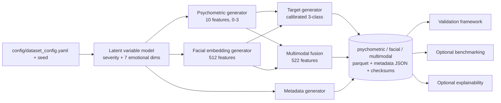

# SMDRPD — Synthetic Multimodal Depression Risk Prediction Dataset

A **reproducible, fully synthetic** multimodal dataset for research on machine-learning-based
depression-risk prediction. It combines 10 simulated psychometric assessment features with 512
simulated facial-expression embedding dimensions (522 features total) and three probabilistically
generated synthetic risk categories.

> **All data are synthetic.** No real patients, medical records, photographs or identifiable
> information are used or included. Labels are **simulated research labels**, not diagnoses.
> The dataset has **not** been validated against real clinical populations, and the synthetic
> embeddings are **not** equivalent to embeddings from any real facial-analysis model.



## Dataset specifications
| Component | Count |
|---|---|
| Psychometric features | 10 (`P01`–`P10`, ordinal 0–3) |
| Facial-expression features | 512 (`F001`–`F512`, float32) |
| Integrated representation | **522** |
| Target variable | `depression_risk` ∈ {0,1,2} |
| Metadata fields | 8 |
| Supported sizes | 10k / 100k / 500k / 1M / 10M (configurable, batched) |

## Installation
```bash
git clone https://github.com/drsanjayagal/SMDRPD.git
cd SMDRPD
python -m venv .venv && source .venv/bin/activate
pip install -r requirements.txt
```

## Generation
```bash
python -m dataset_generator.generate_dataset --records 10000
python -m dataset_generator.generate_dataset --records 100000
python -m dataset_generator.generate_dataset --records 1000000 --batch-size 25000
python -m dataset_generator.generate_dataset --records 100000 --class-scenario balanced
```
Generation is streaming: peak memory is proportional to `--batch-size`, not to the record count.

## Validation and tests
```bash
python -m preprocessing.data_validation --dataset-dir data/processed
pytest tests/ -v
```

## Optional benchmarking and explainability
```bash
python -m benchmarking.unimodal_experiments --models logistic_regression,random_forest
python -m benchmarking.multimodal_experiments --models logistic_regression,mlp
python -m benchmarking.robustness_analysis
python -m benchmarking.ablation_study
```
Benchmark scripts produce real computed metrics on synthetic data only; they are demonstration
infrastructure, not claims about clinical or real-world performance.

## Output files
`psychometric_features.parquet`, `facial_expression_features.parquet`,
`multimodal_features.parquet`, `synthetic_metadata.parquet`, `dataset_metadata.json`,
`generation_config.yaml`, `class_distribution.csv`, `feature_statistics.csv`,
`data_dictionary.csv`, `SHA256SUMS.txt`.

## Reproducibility
Fixed seeds, deterministic per-batch RNG derivation, version-pinned dependencies, checksums and
automated tests. Statistics in `feature_statistics.csv` are computed on a documented,
deterministic prefix sample (default 200,000 records) when the dataset is larger.

## Ethics, limitations, citation
See `docs/ETHICAL_CONSIDERATIONS.md`, `docs/DATASET_CARD.md`, `CITATION.cff`.
**Do not use this dataset for diagnosis, screening, treatment decisions or any clinical purpose.**

## Credits
Dataset developer, generation framework and repository: **Dr. Sanjay Agal**.
This project is dataset development only; it does not create, draft or assign authorship of any
future research manuscript.